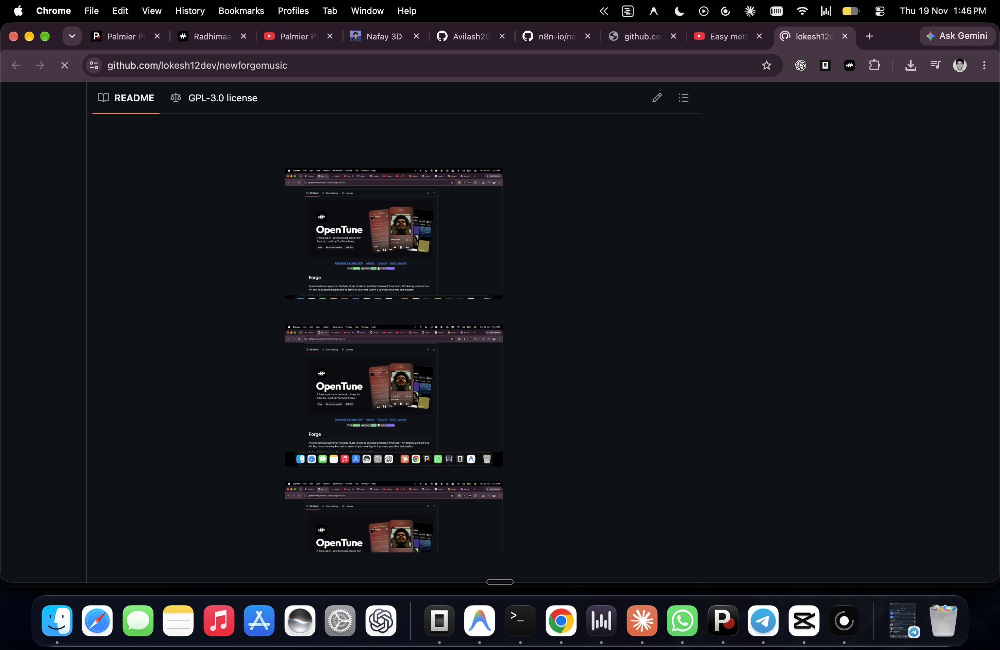

  <a href="https://github.com/lokesh12dev/newforgemusic/releases/latest"><b>Download Forge for Android</b></a>
  &nbsp;·&nbsp;
  <a href="https://lokesh12dev.github.io/newforgemusic/">Website</a>
  &nbsp;·&nbsp;
  <a href="https://github.com/lokesh12dev/newforgemusic/releases">Releases</a>

  
  
  
  

# Forge

Forge is a free, open-source music player for Android, built with Kotlin,
Jetpack Compose and Media3. It plays music from YouTube Music without
requiring an account, API key or server of your own. Sign in only if you
want account-backed likes and playlists.

  

## Features

- Search and browse YouTube Music, with a fast-start player, queue, autoplay
  and background playback.
- Synced lyrics, downloads for offline listening, playlists, listening
  history and a local music library.
- Crossfade, equalizer, loudness controls, playback speed and other optional
  sound tools.
- Optional audio add-ons for alternate sources and lossless files. Source
  availability and quality depend on the service and recording.
- Cast to compatible TVs and speakers, Android Auto, and phone-to-TV remote
  control.
- Internet radio, podcasts, song recognition and listen-together rooms.
- Separate apps or previews for Android TV, Wear OS, iOS, desktop and web.
  Their feature coverage differs from Android.

## Platforms

| Platform | Availability |
| --- | --- |
| Android | Android 8.0 and newer. Install the APK from [GitHub Releases](https://github.com/lokesh12dev/newforgemusic/releases/latest). |
| Android TV | Separate TV APK in the release assets. |
| Wear OS | Watch app source is in the wear directory. |
| iOS and iPadOS | Native project for iOS 16+. It is not distributed through the App Store or TestFlight. |
| Desktop | Early Windows, macOS and Linux app in the desktop directory. |
| Web player | Preview at [lokesh12dev.github.io/newforgemusic/player](https://lokesh12dev.github.io/newforgemusic/player/); the companion extension is required for playback. |

## Install on Android

1. Open the [latest release](https://github.com/lokesh12dev/newforgemusic/releases/latest).
2. Download the arm64-v8a APK for most recent phones, or the universal
   APK if you are unsure which processor your device uses.
3. Open the downloaded file and allow your browser or file manager to install
   apps if Android asks.

The release includes a separate APK for Android TV and a SHA256SUMS.txt
file with checksums. The Android application ID remains stable so an official
Forge build signed with the existing release key can update an existing
installation in place.

## Build and verify

Use JDK 17 or newer and an Android SDK with platform 37.

~~~sh
./gradlew assembleDebug
./gradlew testDebugUnitTest
./gradlew lintDebug
~~~

Debug APKs are written under app/build/outputs/apk/debug/. The release
workflow is in .github/workflows/release.yml; it requires the repository's
official signing key and publishes phone and TV APKs with checksums. A
locally built APK is not a substitute for an official signed release.

For iOS, the Xcode project is generated from ios/project.yml with XcodeGen.
The desktop app can be run with ./gradlew :desktop:run. The web player and
browser extension live under web/.

## Documentation

- [Audio add-ons](docs/audio-addons.md)
- [Service integrations and setup](docs/service-integrations.md)
- [Android TV guide](docs/android-tv.md)
- [Appearance options](docs/appearance-options.md)
- [Publishing notes](docs/publishing.md)

## About the creator

Forge was created by **M. Lokesh** ([@lokesh12dev](https://github.com/lokesh12dev)).
Development is a full-time commitment, carried forward with dedication,
discipline and hard work.

- **Location:** Chennai, ECR
- **GitHub:** [@lokesh12dev](https://github.com/lokesh12dev)
- **Personal site:** [lokesh12dev.github.io](https://lokesh12dev.github.io/)

## Disclaimer

Forge is an independent, open-source project and is not affiliated with or
endorsed by YouTube, Google, Spotify, or any artist or label. Artwork and
music shown in screenshots belong to their respective owners.

## License

Forge is licensed under the GNU General Public License v3.0. See
[LICENSE](LICENSE). Third-party libraries, fonts and data are listed in
[THIRD_PARTY_NOTICES.md](THIRD_PARTY_NOTICES.md).
